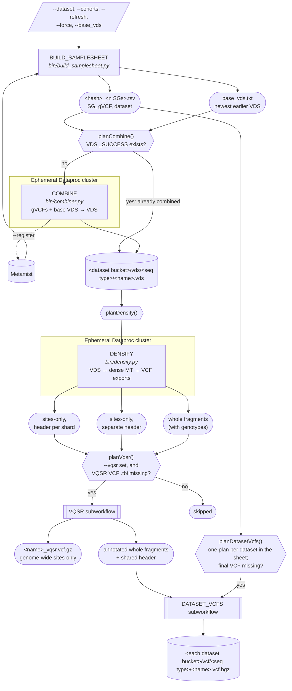
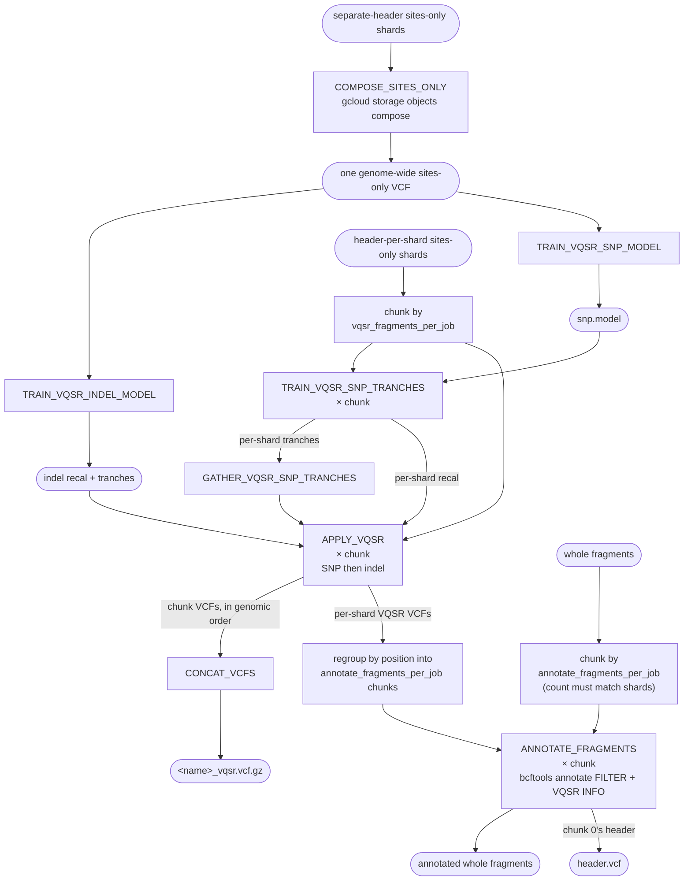
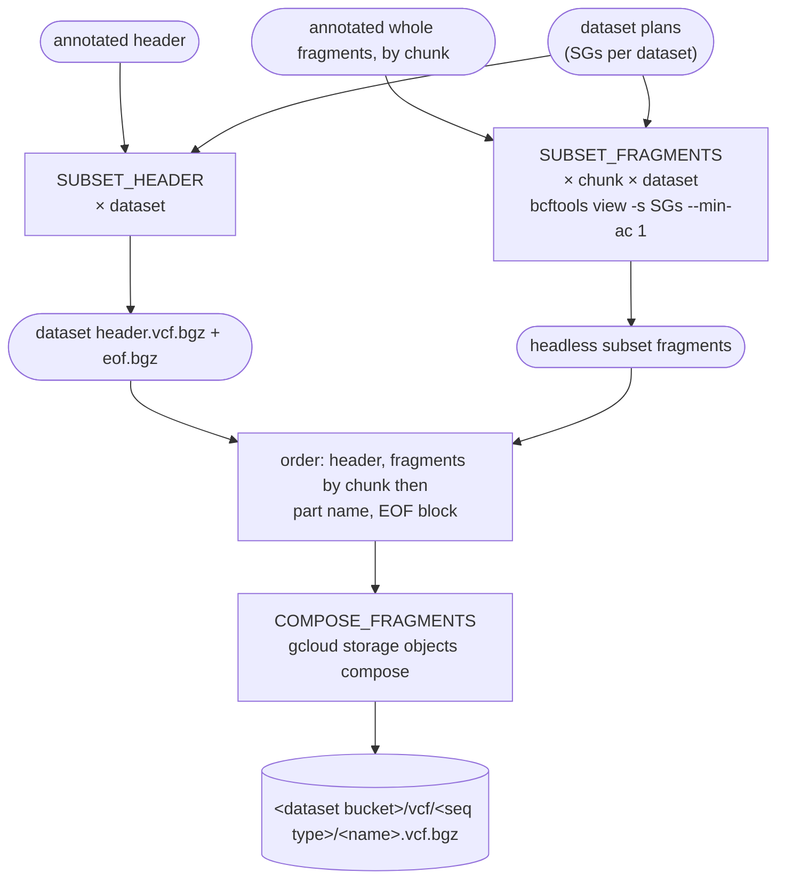

# Workflow diagrams

How a run moves from Metamist cohorts to one VCF per dataset. Boxes are processes, rounded boxes are files or
records, and diamonds are the checks that let a re-run skip finished work. See [DESIGN.md](DESIGN.md) for the reasons
behind each step.

## Overview

## VQSR subworkflow

Two chunkings of the same partitions run side by side. Sites-only shards are chunked by `vqsr_fragments_per_job`
and whole fragments by `annotate_fragments_per_job`. They are paired by their position in the export, not by name.

## DATASET_VCFS subworkflow

Every annotated chunk is subset for every dataset as soon as it's ready. Each dataset's VCF is then joined in GCS
without being downloaded.

